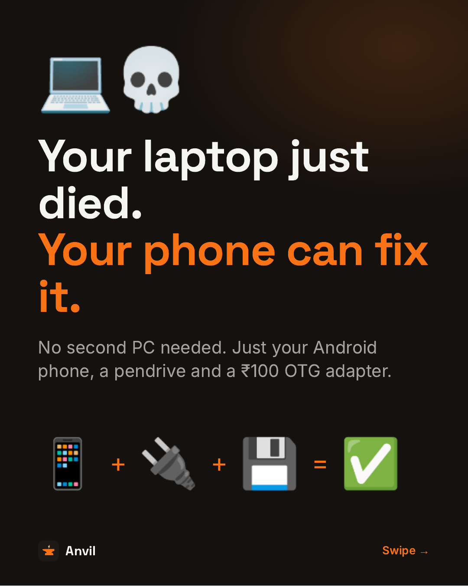
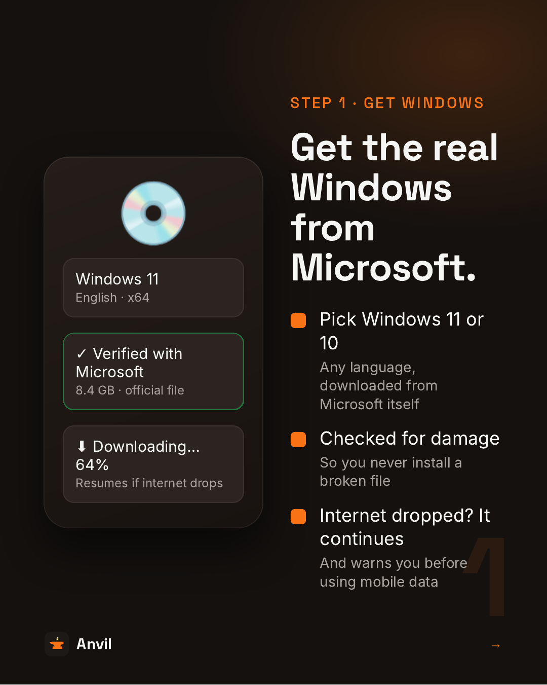
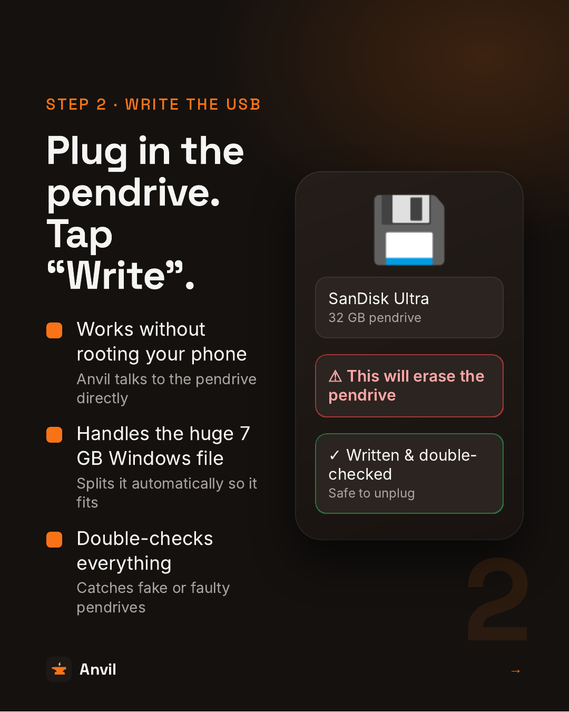
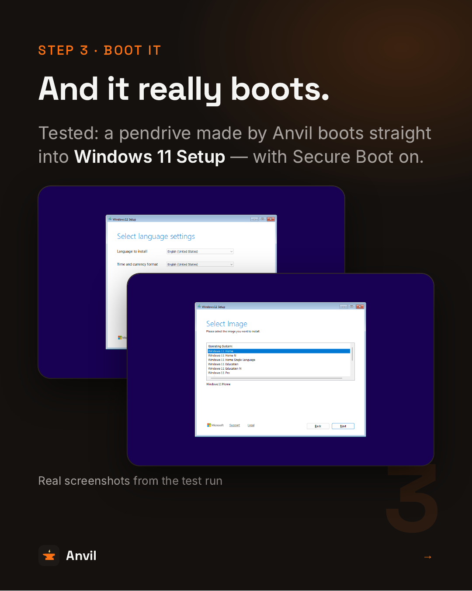
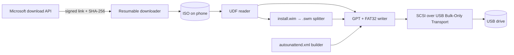
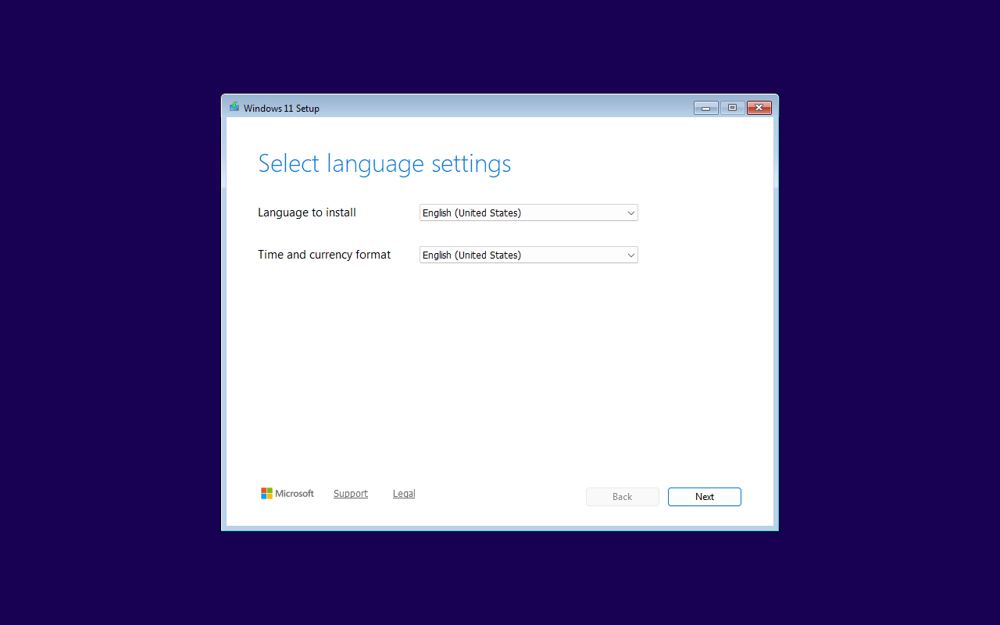
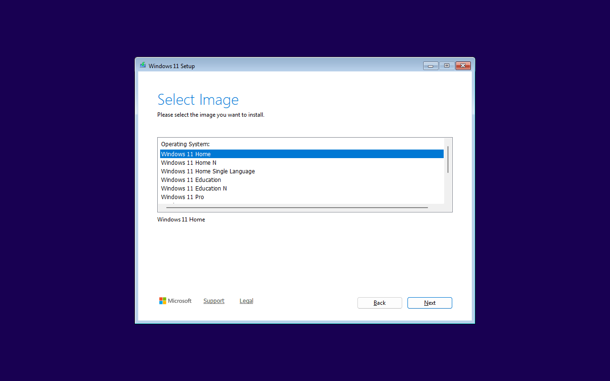

<p align="center">
  
</p>

<h1 align="center">Anvil</h1>

<p align="center">
  <b>Forge a bootable Windows or Linux USB drive with nothing but your Android phone.</b><br>
  No PC. No root. No hunting for ISO files.
</p>

<p align="center">
  
  
  
  
  
</p>

<p align="center">
  <a href="https://github.com/Ruchin-Audichya/anvil-usb/releases/latest/download/Anvil.apk"><b>⬇️ Download the APK</b></a>
</p>

---

Your laptop won't boot. The only computer you have left is in your pocket.

Plug a pendrive into your phone with an OTG adapter, open **Anvil**, pick Windows 11 — Anvil fetches the
official ISO straight from Microsoft, writes a bootable installer, and gets out of your way.

> **Status: beta.** The writing engine is verified end-to-end (details below). Real-device testing across
> phones and USB drives is ongoing — reports are very welcome.

<p align="center">
  
  
  
  
</p>
<p align="center"><sub>Swipe-through overview: <a href="marketing/Anvil-carousel.pdf">Anvil-carousel.pdf</a></sub></p>

## Why Anvil

| | Anvil | EtchDroid | DriveDroid |
|---|:---:|:---:|:---:|
| Linux ISOs | ✅ | ✅ | ✅ |
| **Windows 10/11 ISOs** | ✅ | ❌ | ⚠️ |
| Works **without root** | ✅ | ✅ | ❌ |
| Downloads the official ISO for you | ✅ | ❌ | ❌ |
| Windows 11 requirement bypass, local account | ✅ | ❌ | ❌ |

## Features

**Get the OS**
- 🪟 **Latest Windows 11 / 10 (x64 & Arm64) from Microsoft's own servers** — the same session-based API the
  official download page uses. Pick a language; Anvil gets a fresh signed link. Nothing is mirrored or re-hosted.
- 🔐 **Verified downloads** — every Windows ISO is checked against the SHA-256 Microsoft publishes.
- 📶 **Resumable** — survives network drops (HTTP Range + ETag), app restarts and expired 24-hour links.
  Warns before using mobile data and checks free space first.
- 📁 Or use any ISO you already have.

**Write the USB drive**
- 🐧 **Linux** (Ubuntu, Mint, Fedora, Debian, …) — raw hybrid-ISO write, like `dd`.
- 🪟 **Windows** — GPT (or MBR) + FAT32, UEFI-bootable with Secure Boot. Windows' 7+ GB `install.wim` is too big
  for FAT32, so Anvil **splits it into `install.swm` parts on the fly** — streamed straight from the ISO to the
  stick, no temporary files, no extra phone storage needed.
- ✔️ **Read-back verification** of everything written — catches failing and fake-capacity drives.
- 🧠 Detects what you picked by looking *inside* the ISO, so renamed or custom ISOs are handled correctly.
- 🔌 Unplug-safe: clear recovery instructions if the drive disconnects mid-write.

**Customize Windows Setup** (optional, all toggles)
- Skip Windows 11's **TPM 2.0 / Secure Boot / RAM / CPU** checks
- **Local account** — no Microsoft account, works offline
- Skip the privacy questions, reduce telemetry and ads
- Stop surprise **BitLocker** auto-encryption (no recovery-key lockouts later)
- Remove preinstalled promo apps (Clipchamp, News, Solitaire, Teams, Copilot…)
- Use your phone's time zone, region and keyboard

**Built for real phones**
- Runs as a foreground service with a progress notification — switch apps or turn the screen off.
- Progress with speed, ETA and a stage checklist. Battery warning below 30 %.
- English and हिन्दी. Material 3, light and dark themes.

## How it works

Android doesn't let apps write raw sectors to a USB stick. Anvil doesn't ask it to: it claims the drive through
the **USB Host API** and speaks the USB Mass Storage protocol (Bulk-Only Transport + SCSI) itself — so the
whole drive is writable without root.



Everything below the UI is plain Kotlin, unit-tested on a desktop JVM against a simulated USB stick:

| Module | What it does |
|---|---|
| `core:blockdev` | USB Mass Storage Bulk-Only Transport, SCSI commands, error recovery, read-back verification |
| `core:image` | Classifies images: hybrid Linux ISO, Windows ISO, disk image |
| `core:writer` | Raw writer (Linux) and Windows writer pipeline |
| `core:udf` | Read-only UDF reader — Windows ISOs keep their real file tree in UDF |
| `core:wim` | Splits `install.wim` into `.swm` parts by re-packaging compressed resources (no recompression) |
| `core:fat` | GPT/MBR partitioner and a single-pass FAT32 writer (contiguous files, generated FAT) |
| `core:unattend` | `autounattend.xml` generator for the Windows Setup options |
| `core:download` | Resumable downloader with SHA-256 verification |
| `core:catalog` | Microsoft ISO link resolver |
| `app` | Jetpack Compose UI, Hilt, foreground service, Android USB transport |
| `tools:devcli` | Desktop CLI that runs the same engine against image files |

See [docs/ARCHITECTURE.md](docs/ARCHITECTURE.md) for the deep dive.

## Verified, not just compiled

Using a real Windows 11 ISO (build 26300, 8.4 GB) downloaded through Anvil's own downloader:

- Written to a 16 GB disk image by the same engine the app uses — 978 files, `install.wim` (7.6 GB) split into
  two `.swm` parts, read-back SHA-256 ✅
- `sgdisk -v` ✅ · `fsck.fat` ✅ · Linux kernel mounts it ✅ · every file byte-identical to the ISO ✅
- `wimlib-imagex verify` on the split parts: all 11 editions valid ✅
- Booted in QEMU + UEFI firmware with **Secure Boot enforced**: Windows Setup starts and lists every edition ✅

<p align="center">
  
  
</p>

## Get started

1. [**Download the APK**](https://github.com/Ruchin-Audichya/anvil-usb/releases/latest/download/Anvil.apk) (or browse [Releases](https://github.com/Ruchin-Audichya/anvil-usb/releases)) and install it — allow "Install unknown apps" when Android asks.
2. Plug a USB drive (16 GB+ for Windows, 8 GB+ for Linux) into your phone with an OTG adapter.
3. **Download Windows** → choose version & language → **Download** → **Write this ISO to a USB drive**.
   Or **Write an ISO** and pick a file you already have.
4. Boot your PC from the USB drive (boot menu key: HP F9, Dell F12, Lenovo F12, ASUS Esc/F8, Acer F12).

**Updating from v0.3.x?** v0.4.0 is signed with a new release key, so uninstall the old version once before installing it. Future updates install over the top as normal.

**If installing is blocked:** Anvil isn't on the Play Store yet, so Android double-checks it.
- Chrome says *"File might be harmful"* → tap **Download anyway**.
- Play Protect says *"Unsafe app blocked"* / *"Scan app"* → **More details → Install anyway** (or scan, then install).
- Samsung: if nothing happens or it says *"Blocked by Auto Blocker"*, turn off **Settings → Security and privacy → Auto Blocker**
  while installing, then turn it back on.

> ⚠️ Writing erases everything on the USB drive. Anvil asks you to confirm with the drive's name and size.

## Build from source

Requires JDK 17+ and the Android SDK (platform 37).

```bash
./gradlew :app:assembleDebug      # APK → app/build/outputs/apk/debug/
./gradlew :app:assembleRelease    # signed release APK, if ANVIL_KEYSTORE* is set in ~/.gradle/gradle.properties
./gradlew test                    # unit tests (USB protocol, FAT32, WIM split, UDF, downloader, …)
./gradlew :core:catalog:liveTest  # resolve real links from Microsoft (network)
```

Desktop CLI (handy for development — writes to an image file instead of a USB drive):

```bash
./gradlew :tools:devcli:installDist
tools/devcli/build/install/anvil-dev/bin/anvil-dev download-windows WINDOWS_11_X64 English ~/isos
tools/devcli/build/install/anvil-dev/bin/anvil-dev write-windows ~/isos/Win11.iso usb.img
```

## Roadmap

- [x] USB detection and raw writes without root
- [x] Windows writer: GPT + FAT32 + `install.wim` split, UEFI + Secure Boot
- [x] Official Windows downloads with resume and SHA-256 verification
- [x] Windows 11 requirement bypass, local account, privacy and debloat options
- [ ] Linux catalog (Ubuntu & flavours, Mint, Fedora, Debian) with fastest-mirror selection and GPG-verified checksums
- [ ] Stream-to-USB: write while downloading, for phones with little free storage
- [ ] NTFS layout with UEFI:NTFS for ISOs with very large files; legacy BIOS boot
- [ ] Driver injection (Intel RST/VMD storage, Wi-Fi) per laptop model
- [ ] Rescue toolkit: multi-boot drive, data-rescue live USB, offline troubleshooting guides
- [ ] Guided install companion: per-brand boot keys and step-by-step screens

## Legal

Anvil is an independent project, **not affiliated with or endorsed by Microsoft**. Windows ISOs are downloaded
directly from Microsoft's servers; you need a valid Windows licence to activate Windows. Linux distributions
are subject to their own licences.

Approaches and formats were studied from the excellent open-source projects
[Rufus](https://github.com/pbatard/rufus), [wimlib](https://wimlib.net) and
[Fido](https://github.com/pbatard/Fido). Anvil's code is an independent implementation.

## Author

Created by **Ruchin Audichya** — [@Ruchin-Audichya](https://github.com/Ruchin-Audichya).

If Anvil saved your laptop (or your weekend), consider giving the repo a ⭐.

## License

[MIT](LICENSE) © 2026 Ruchin Audichya
